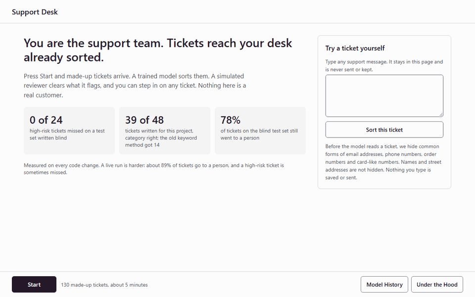
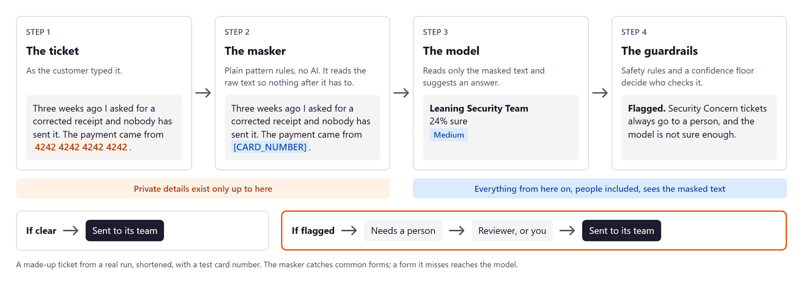
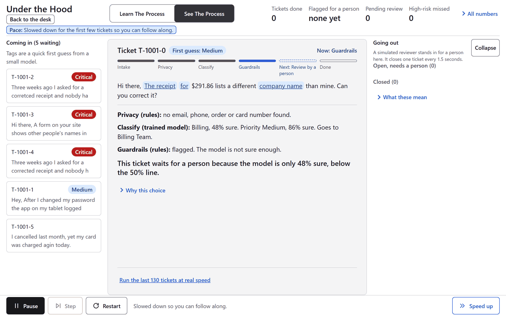
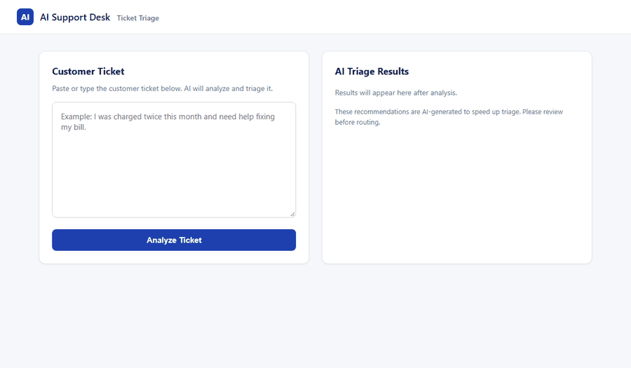

# AI Support Desk: Ticket Triage

**A live support desk where a trained model sorts every ticket, guardrails decide what a person must check, and you can step in on any ticket. It all runs in your browser.**

### [Open the live desk](https://goudymt.github.io/ai-support-desk-triage/)

[Under the Hood](https://goudymt.github.io/ai-support-desk-triage/under-the-hood.html) | [Model History](https://goudymt.github.io/ai-support-desk-triage/model-history.html) | [The original prototype](https://goudymt.github.io/ai-support-desk-triage/capstone/prototype/AI_Support_Desk_Triage_Prototype.html)



**Version 1.0.** Tickets are made up and the reviewer is simulated. Nothing is connected to a real help desk, and nothing you type leaves the page.

This began as a keyword prototype for a course capstone. It is now a trained model, a rules layer, a privacy mask and a measured test setup, shown live.

## What you can do

| Page | What it shows |
|---|---|
| **[The desk](https://goudymt.github.io/ai-support-desk-triage/)** | The receiving end. Press Start and a run of 130 made-up tickets plays out in about 5 minutes. Each one goes to a team or waits in Needs a person, highest risk first. Step in with Review, or press Approve when the model is at least 70% sure. |
| **Try a ticket** | Type your own support message and see its category, priority, team and whether a person is needed. |
| **The report** | An after action report for the run so far, with the numbers behind it. Print it or save it as a PDF. |
| **[Under the Hood](https://goudymt.github.io/ai-support-desk-triage/under-the-hood.html)** | The same pipeline slowed down, one stage at a time, with the words that moved each decision. |
| **[Model History](https://goudymt.github.io/ai-support-desk-triage/model-history.html)** | Every model against the baseline, measured the same way each time. |

## How it works



1. **The ticket.** It arrives as the customer typed it. Here the tickets are made up.
2. **The masker.** Plain pattern rules, no AI, swap common forms of email addresses, phone numbers, order numbers and card numbers for labels like `[CARD_NUMBER]`. Names and street addresses are not hidden, and a form the masker misses reaches the model.
3. **The model.** It reads only the masked text and suggests an answer with how sure it is. It is two small classifiers, TF-IDF word and word-pair counts into logistic regression, trained in Python with scikit-learn and exported to JSON. A TypeScript scorer runs them in the browser and agrees with Python on every evaluation ticket.
4. **The guardrails.** Keyword rules catch security incidents, accessibility issues, billing disputes, threats, escalated complaints and vague tickets, and they can raise a priority. Any ticket the model is under 50% sure about goes to a person.

Then a clear ticket goes to its team, and a flagged one waits in Needs a person. The model only suggests. A person, here a simulated reviewer that is wrong 5% of the time, clears what is flagged, and you can take any ticket yourself.

There is no server. The site is static, makes no calls after loading its model file, and stores nothing.

### Watch it think

[](https://goudymt.github.io/ai-support-desk-triage/under-the-hood.html)

**[Open Under the Hood](https://goudymt.github.io/ai-support-desk-triage/under-the-hood.html)** to see it live.

## What the current model delivers

The first table is re-measured or checked in CI on each code change. The second is a count of 40 full desk runs, and two of its rows are estimates.

| Measure | Keyword prototype | Current model |
|---|---|---|
| Category right on tickets it never saw | 33.6% | **57.3%** |
| Category right on 48 tickets written for this project | 14 of 48 | **39 of 48** |
| High-risk tickets missed on a test set written blind | not measured | **0 of 24** |

Across 40 full desk runs, seeds 2000 to 2039, with no one stepping in:

| Per run of 130 tickets | Result |
|---|---|
| Category right, model alone | 58% |
| Category right after review, with a simulated reviewer assumed right 95% of the time | 94.5% |
| Sent to a person | 89% |
| Sorted fully right with no person | about 12 tickets |
| Time saved (estimate, at 2 minutes a ticket) | about 24 minutes |
| Value saved (estimate, at $21.53 an hour) | about $8.52 |

**What this means.** The model gets about 1.7 times as many categories right as the keyword method, and the guardrails keep risky tickets in front of a person. It is also a first model. It is cautious, so most tickets still go to a person, and a live run is harder than the blind test set: 30 high-risk tickets across those 40 runs went out without a person, in 17 of the runs. The goal of the next versions is more right answers and fewer tickets that need a person, with none of those misses. [Model History](https://goudymt.github.io/ai-support-desk-triage/model-history.html) will show each step, and the [model card](ml/MODEL_CARD.md) has the full method and limits.

The two estimates use less than the lowest figure IT desk vendors publish for sorting a ticket, and the US median pay for customer service representatives (Bureau of Labor Statistics, May 2025). You can change both on the desk.

## How it is tested

- About 1,300 unit tests, and browser tests in Chromium, Firefox and WebKit, on Windows and on Linux CI.
- The model retrains in CI and must match the shipped file, and Python and TypeScript must score the same.
- Models are measured on ticket wording they never trained on, using four folds, and on a 60-ticket set written blind and frozen before any measurement.
- Page size budgets are checked on every change.

## Responsible AI

| Risk | What the desk does |
|---|---|
| Privacy | Fictional tickets only. Common forms of personal details are hidden before the model reads a ticket. Nothing typed is stored or sent. |
| Wrong answers | Everything is a suggestion. Below 70% sure there is no one-press Approve. Wrong quick approvals are counted in the report. |
| High-risk tickets | Safety rules send the ones they catch to a person whatever the model says, and misses are the headline number. |
| Overclaiming | Every figure is measured or a stated assumption. Time and pay can be edited on the desk; the simulated reviewer's 95% is fixed. Live runs and test sets are labeled apart. |
| Over-automation | The system never replies to a customer. |

## Run it locally

Needs Node 22.

```bash
npm --prefix web ci
npm --prefix web run build
npm --prefix web run preview
```

The full check is `npm --prefix web run gate`, then `npm --prefix web run e2e`. Training lives in `ml/`; see the [model card](ml/MODEL_CARD.md).

## How it grew

It started as seven course checkpoints and a single-page keyword prototype. The prototype is kept as it was, and it is the baseline every model is measured against.



| Checkpoint | Module | What was added |
|---|---|---|
| [1](capstone/checkpoints/Max_Goudy_Capstone_Checkpoint_1.docx) (Word download) | Define the support problem | Problem, primary user, the five outputs |
| [2](capstone/checkpoints/Max_Goudy_Capstone_Checkpoint_2.pdf) | Draft requirements with AI | Feature list, three sample tickets with expected results |
| [3](capstone/checkpoints/Max_Goudy_Capstone_Checkpoint_3.pdf) | Input and output logic | Field definitions, nine categories, keyword fallback plan |
| [4](capstone/checkpoints/Max_Goudy_Capstone_Checkpoint_4.pdf) | Build a simple interface | The working prototype |
| [5](capstone/checkpoints/Max_Goudy_Capstone_Checkpoint_5.pdf) | Roles and maintenance | Team roles, review cadence, change log |
| [6](capstone/checkpoints/Max_Goudy_Capstone_Checkpoint_6.pdf) | Responsible AI guardrails | Risk checklist, always-review cases, privacy note |
| [7](capstone/checkpoints/Max_Goudy_Capstone_Checkpoint_7.pdf) | Agentic workflow | Human approval points, future agent plan, Think, Act, Observe example |

## Credits and license

Built by Max Goudy for the AI Essentials course (iZen, SkillBridge with Boots2Bytes), with AI coding assistance. The course's handouts, rubric and templates are not included. The project title, the scenario, three of its sample tickets and the category and priority lists come from the course's Track 3 guide; the checkpoints are my answers built on them.

License: [MIT](LICENSE).
