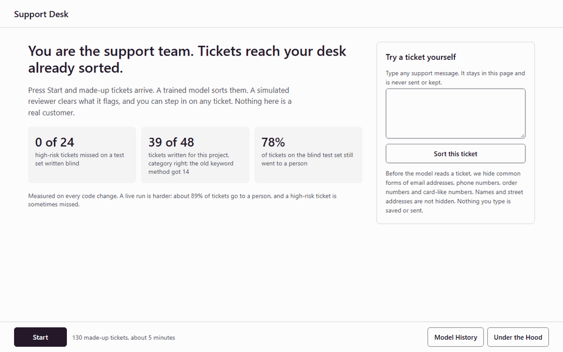
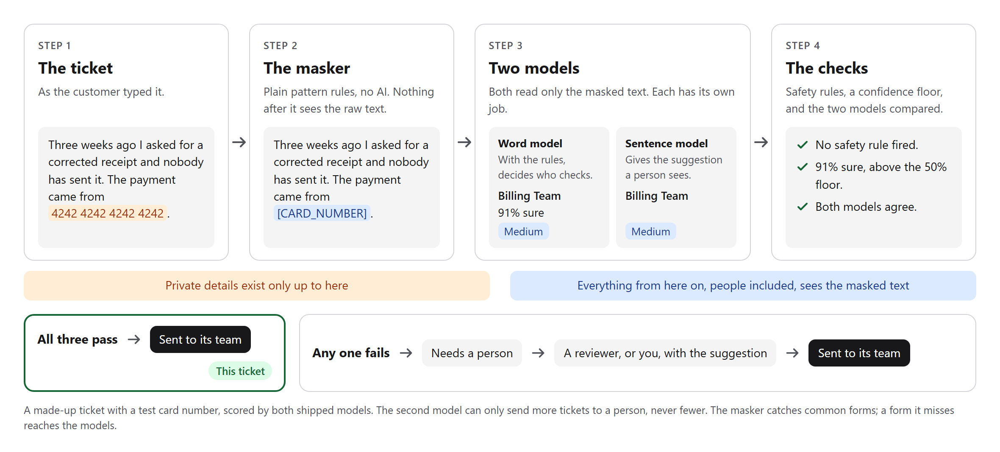
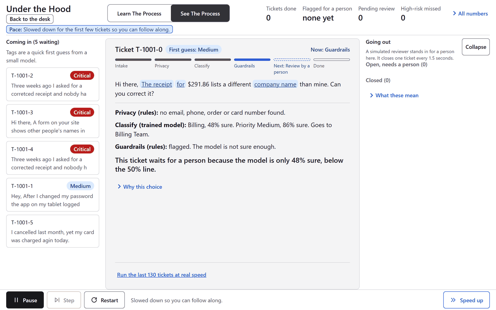
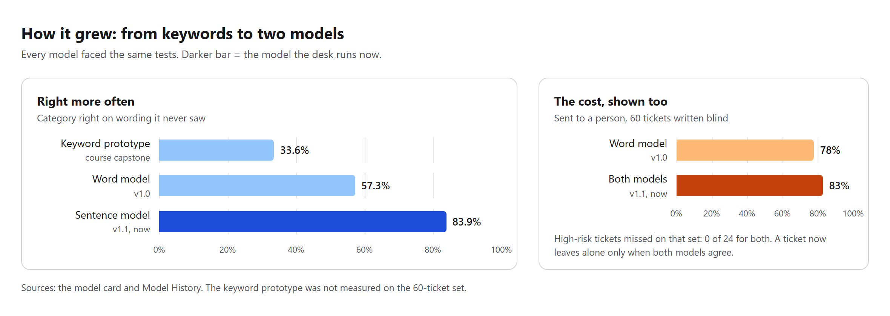
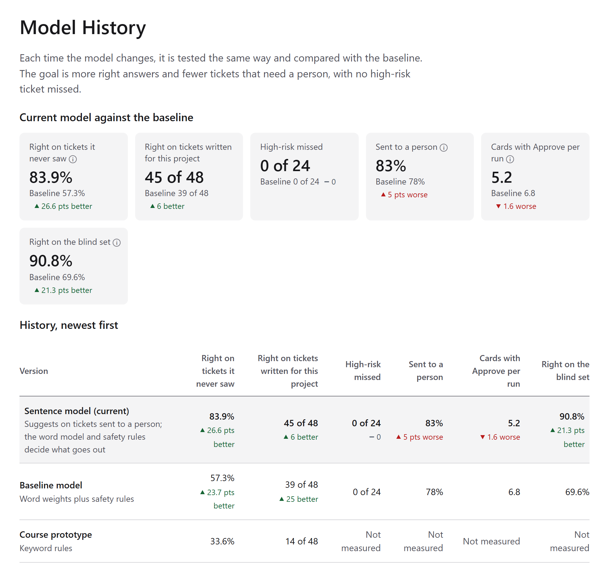
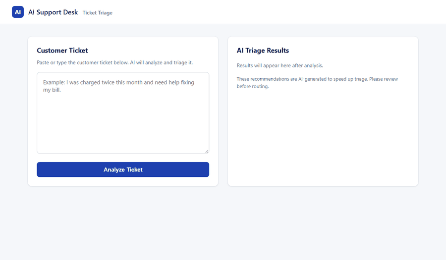

# AI Support Desk: Ticket Triage

**A live support desk where a trained model sorts every ticket, guardrails decide what a person must check, and you can step in on any ticket. It all runs in your browser.**

### [Open the live desk](https://goudymt.github.io/ai-support-desk-triage/)

[Under the Hood](https://goudymt.github.io/ai-support-desk-triage/under-the-hood.html) | [Model History](https://goudymt.github.io/ai-support-desk-triage/model-history.html) | [The original prototype](https://goudymt.github.io/ai-support-desk-triage/capstone/prototype/AI_Support_Desk_Triage_Prototype.html)



**Version 1.1.** Tickets are made up and the reviewer is simulated. Nothing is connected to a real help desk, and nothing you type leaves the page.

This began as a keyword prototype for a course capstone. It is now a trained model, a rules layer, a privacy mask and a measured test setup, shown live.

## What you can do

| Page | What it shows |
|---|---|
| **[The desk](https://goudymt.github.io/ai-support-desk-triage/)** | The receiving end. Press Start, the sentence model and its runtime download (about 38.5 MB, from this site), and a run of 130 made-up tickets plays out in about 5 minutes. Each one goes to a team or waits in Needs a person, highest risk first. Step in with Review, or press Approve when both models agree and the word model is at least 70% sure. |
| **Try a ticket** | Type your own support message and see its category, priority, team and whether a person is needed. |
| **The report** | An after action report for the run so far, with the numbers behind it. Print it or save it as a PDF. |
| **[Under the Hood](https://goudymt.github.io/ai-support-desk-triage/under-the-hood.html)** | The same pipeline slowed down, one stage at a time, with the words that moved each decision. |
| **[Model History](https://goudymt.github.io/ai-support-desk-triage/model-history.html)** | Every model against the baseline, measured the same way each time. |
| **[Get the model](https://goudymt.github.io/ai-support-desk-triage/get-the-model.html)** | The sentence model's files to download, with a short Python sample, the license and the notice of changes. |

## How it works



1. **The ticket.** It arrives as the customer typed it. Here the tickets are made up.
2. **The masker.** Plain pattern rules, no AI, swap common forms of email addresses, phone numbers, order numbers and card numbers for labels like `[CARD_NUMBER]`. Names and street addresses are not hidden, and a form the masker misses reaches the model.
3. **Two models.** Both read only the masked text. The word model is two small classifiers, TF-IDF word and word-pair counts into logistic regression, trained in Python with scikit-learn and exported to JSON; a TypeScript scorer runs them in the browser and agrees with Python on every evaluation ticket. With the rules, it decides who must check a ticket. The sentence model is a small sentence encoder (all-MiniLM-L6-v2) trained on 20,000 generated tickets, shipped as an 8-bit ONNX file and run in the browser; it gives the suggestion a person sees.
4. **The checks.** Keyword rules catch security incidents, accessibility issues, billing disputes, threats, escalated complaints and vague tickets, and they can raise a priority. Any ticket the word model is under 50% sure about goes to a person, and so does any ticket where the two models disagree.

Then a ticket that passes every check goes to its team, and the rest wait in Needs a person. The second model can only send more tickets to a person, never fewer. The models only suggest. A person, here a simulated reviewer that is wrong 5% of the time, clears what is flagged, and you can take any ticket yourself.

There is no server. The site is static, makes no calls after loading its model files, and stores nothing.

The [technical guide](docs/guide/README.md) explains each design choice with a diagram, what it was measured to do, and the model update that was tested and not released.

### Watch it think

[](https://goudymt.github.io/ai-support-desk-triage/under-the-hood.html)

**[Open Under the Hood](https://goudymt.github.io/ai-support-desk-triage/under-the-hood.html)** to see it live.

## What the current model delivers



The desk runs two models: the word model decides what may leave without a person, and the sentence model checks it and gives the suggestion on every ticket a person sees. The first table is re-measured or checked in CI on each code change.

| Measure | Keyword prototype | Word model | Sentence model (current) |
|---|---|---|---|
| Category right on tickets it never saw | 33.6% | 57.3% | **83.9%** |
| Category right on 48 tickets written for this project | 14 of 48 | 39 of 48 | **45 of 48** |
| Category right on 2,000 blind tickets, read once | not measured | 69.6% | **90.8%** |
| High-risk tickets missed on a test set written blind | not measured | 0 of 24 | **0 of 24** |
| Sent to a person, 60 tickets written blind | not measured | 78% | 83% |

More tickets now go to a person, on purpose: one leaves alone only when both models agree. On the 2,000 blind tickets, the suggestion a person sees is right on the category 88.8% of the time, against 62.9% for the word model's answer.

The first release, on the word model alone, across 40 full desk runs, seeds 2000 to 2039, with no one stepping in (two of these rows are estimates):

| Per run of 130 tickets | Result |
|---|---|
| Category right, model alone | 58% |
| Category right after review, with a simulated reviewer assumed right 95% of the time | 94.5% |
| Sent to a person | 89% |
| Sorted fully right with no person | about 12 tickets |
| Time saved (estimate, at 2 minutes a ticket) | about 24 minutes |
| Value saved (estimate, at $21.53 an hour) | about $8.52 |

**What this means.** The sentence model gets the category right far more often than the word model, and the guardrails keep risky tickets in front of a person. It has not cut the work: most tickets still go to a person, and on the 2,000 blind tickets 38 high-risk tickets went out without one (61 with the word model alone). Fewer tickets for a person, with none of those misses, is still the goal. Two simulated 90-day runs of weekly retraining did not show real growth, and are reported as measured.

[](https://goudymt.github.io/ai-support-desk-triage/model-history.html)

[Model History](https://goudymt.github.io/ai-support-desk-triage/model-history.html) shows each step, and the [model card](ml/MODEL_CARD.md) has the full method and limits.

The two estimates use less than the lowest figure IT desk vendors publish for sorting a ticket, and the US median pay for customer service representatives (Bureau of Labor Statistics, May 2025). You can change both on the desk.

## How it is tested

- About 1,300 unit tests, and browser tests in Chromium, Firefox and WebKit, on Windows and on Linux CI.
- The model retrains in CI and must match the shipped file, and Python and TypeScript must score the same.
- Models are measured on ticket wording they never trained on, using four folds, and on a 60-ticket set written blind and frozen before any measurement.
- Page size budgets are checked on every change.

## Responsible AI

| Risk | What the desk does |
|---|---|
| Privacy | Fictional tickets only. Common forms of personal details are hidden before the model reads a ticket. Nothing typed is stored or sent. |
| Wrong answers | Everything is a suggestion. Below 70% sure, or when the two models disagree, there is no one-press Approve. Wrong quick approvals are counted in the report. |
| High-risk tickets | Safety rules send the ones they catch to a person whatever the model says, and misses are the headline number. |
| Overclaiming | Every figure is measured or a stated assumption. Time and pay can be edited on the desk; the simulated reviewer's 95% is fixed. Live runs and test sets are labeled apart. |
| Over-automation | The system never replies to a customer. |

## Run it locally

Needs Node 22.

```bash
npm --prefix web ci
npm --prefix web run build
npm --prefix web run preview
```

The full check is `npm --prefix web run gate`, then `npm --prefix web run e2e`. Training lives in `ml/`; see the [model card](ml/MODEL_CARD.md).

## How it grew

It started as seven course checkpoints and a single-page keyword prototype. The prototype is kept as it was, and it is the baseline every model is measured against.



| Checkpoint | Module | What was added |
|---|---|---|
| [1](capstone/checkpoints/Max_Goudy_Capstone_Checkpoint_1.docx) (Word download) | Define the support problem | Problem, primary user, the five outputs |
| [2](capstone/checkpoints/Max_Goudy_Capstone_Checkpoint_2.pdf) | Draft requirements with AI | Feature list, three sample tickets with expected results |
| [3](capstone/checkpoints/Max_Goudy_Capstone_Checkpoint_3.pdf) | Input and output logic | Field definitions, nine categories, keyword fallback plan |
| [4](capstone/checkpoints/Max_Goudy_Capstone_Checkpoint_4.pdf) | Build a simple interface | The working prototype |
| [5](capstone/checkpoints/Max_Goudy_Capstone_Checkpoint_5.pdf) | Roles and maintenance | Team roles, review cadence, change log |
| [6](capstone/checkpoints/Max_Goudy_Capstone_Checkpoint_6.pdf) | Responsible AI guardrails | Risk checklist, always-review cases, privacy note |
| [7](capstone/checkpoints/Max_Goudy_Capstone_Checkpoint_7.pdf) | Agentic workflow | Human approval points, future agent plan, Think, Act, Observe example |

## Credits and license

Built by Max Goudy for the AI Essentials course (iZen, SkillBridge with Boots2Bytes), with AI coding assistance. The course's handouts, rubric and templates are not included. The project title, the scenario, three of its sample tickets and the category and priority lists come from the course's Track 3 guide; the checkpoints are my answers built on them.

License: [MIT](LICENSE).
