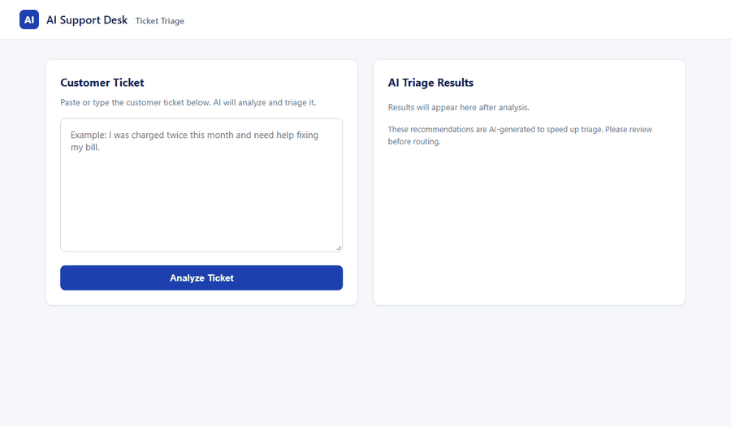
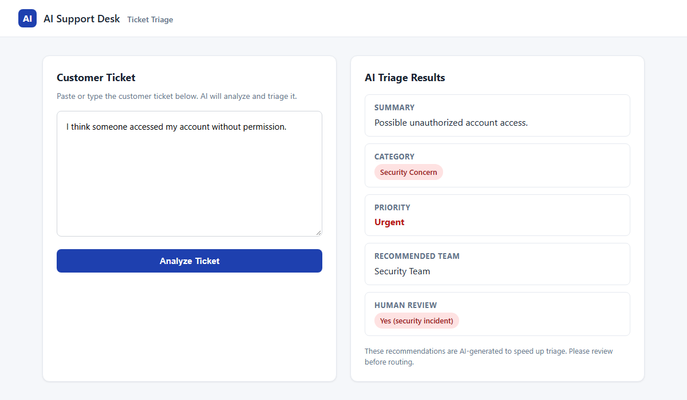
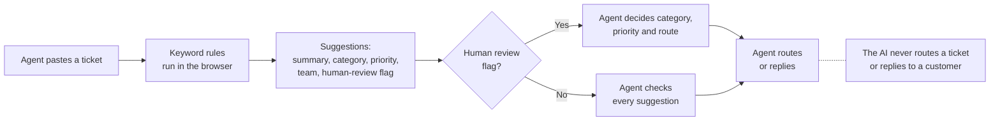
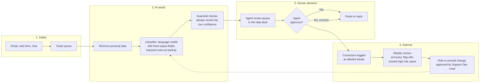

# AI Support Desk: Ticket Triage Assistant

A browser prototype that reads a customer support ticket and suggests a summary, category, priority, team and
human-review flag, so a support agent can sort tickets faster while keeping every decision.

**Status:** course capstone (AI Essentials, Track 3: AI-Assisted Coding Prototype). Working prototype, keyword
rules only, fictional tickets only. Not connected to any real help desk.

**[Try the live demo](https://goudymt.github.io/ai-support-desk-triage/capstone/prototype/AI_Support_Desk_Triage_Prototype.html)**

## The problem

Scenario (fictional, from the course brief): a small software company gets hundreds of support tickets a week. Agents spend much of their time reading each
one to work out its category, priority and next step before they can answer. That slows replies and makes it
easier to miss an urgent or sensitive ticket.

**Who it is for:** support agents first. Support managers and security reviewers see the flagged tickets.

## What it does

Paste a ticket, press **Analyze Ticket**, and get five suggestions:

| Output | Values |
|---|---|
| Summary | One fixed sentence per category (not written for the specific ticket) |
| Category | Billing, Technical Issue, Account Access, Security Concern, Accessibility Support, Other |
| Priority | Medium, High, Urgent (Low is planned, not coded) |
| Recommended team | The team best placed to handle it |
| Human review | Yes or No, with the reason when Yes |

## How it works

Everything runs in one HTML file with no server, no outside calls and no stored data. The rules are plain
keyword checks: anyone reading the code can see why a ticket got its label, though the page itself does not
show which keyword matched.

## Try it

- **Live:** use the demo link above.
- **Locally:** download `capstone/prototype/AI_Support_Desk_Triage_Prototype.html` and open it in any browser.

Tickets to try: `I think someone accessed my account without permission.` or
`I was charged twice this month and need help fixing my bill.`

## Responsible AI

Guardrails from the design (Checkpoints 6 and 7). They describe the planned system; of these guardrails, the test results below
check only the human-review flags, and the known limits list what the prototype does not yet do.

| Risk | Guardrail |
|---|---|
| Privacy | Fictional tickets only. Nothing is stored or sent anywhere. |
| Wrong priority | Priority is shown as a suggestion; the agent confirms before acting. |
| Bias | Flagged results reviewed weekly; rules updated when a pattern of unfair treatment shows. |
| Sensitive tickets | Flagged for human review automatically. |
| Over-automation | A warning under every result. The prototype shows: "These recommendations are AI-generated to speed up triage. Please review before routing." |

**Always reviewed by a human:** security incidents, accessibility issues, billing disputes, threatening or
abusive language, and vague tickets. **Always a human action:** final routing, any customer reply, closing or
escalating a ticket, and changing the rules.

## Test results

Eight tickets run through the prototype's own code, unchanged. The Source column says where each expected
result comes from. Rows 4, 5, 7 and 8 were written for this README from the design's always-review rules, so
they are a weaker test than rows 1 to 3 and 6, which a checkpoint set before the code was judged.

| # | Ticket | Expected | Source | Actual | Match |
|---|---|---|---|---|---|
| 1 | I was charged twice this month and need help fixing my bill. | Billing, Medium, review Yes | Checkpoint 2 | Billing, Medium, Billing Team, review Yes (billing dispute) | Yes |
| 2 | I think someone accessed my account without permission. | Security Concern, Urgent, review Yes | Checkpoint 2 | Security Concern, Urgent, Security Team, review Yes (security incident) | Yes |
| 3 | The app keeps crashing when I try to upload a file. | Technical Issue, High, review No | Checkpoint 2 | Technical Issue, High, Technical Support, review No | Yes |
| 4 | I lost access to my account. | Account Access, High, review No | Design rules | Account Access, High, Account Support, review No | Yes |
| 5 | My screen reader cannot read the checkout page. | Accessibility Support, High, review Yes | Design rules | Accessibility Support, High, Accessibility Team, review Yes (accessibility issue) | Yes |
| 6 | This is not working | review Yes (vague ticket) | Checkpoint 6 | Technical Issue, High, review No | **No** |
| 7 | Fix this now or I will come to your office and make you regret it. | review Yes (threatening language) | Design rules | Other, Medium, review No | **No** |
| 8 | I was charged twice and now I cannot log in to my account. | Billing and account, review Yes | Design rules | Account Access, High, review Yes (billing dispute) | **Partly** |

**5 of 8 match** on category, priority and review flag. Summaries were not scored: Checkpoint 2 expects
"Customer reports duplicate monthly charge." where the code returns its fixed billing sentence. The three
misses are the reason for the known limits below.

## Known limits

- **The page calls keyword output "AI".** Its labels ("AI will analyze", "AI Triage Results") describe the planned
  system; this version has no model.
- **The warning leaves out replies.** Checkpoint 6 planned "Please review before routing or responding to the
  customer"; the page says only "before routing", and Checkpoint 6's note that it does more is wrong.
- **Summaries are fixed per category.** Every billing ticket gets the same sentence, so a summary never names the
  actual problem.
- **Vague tickets are not caught.** Checkpoint 6 recorded this case as passing; it does not. "This is not working" matches the keyword "not working" and is labeled a
  confident Technical Issue with no review.
- **Threatening language is not caught.** There is no rule for it yet, although the design requires review.
- **Six of nine planned categories are coded.** Product Question, Urgent Complaint and Shipping/Order Issue fall
  through to Other.
- **A later rule overwrites an earlier one.** A ticket that mentions both billing and login ends up as Account
  Access but keeps the billing review reason.
- **Keywords match inside words.** "ada" (for ADA) also matches "Canada", so that ticket is flagged as
  accessibility.
- **Keyword rules only.** The design plans a language model with these rules as a backup; that part is not built.

## At scale (proposed, not built)

- **Intake:** tickets from every channel land in one queue.
- **AI assist:** personal data is removed before any model sees the text; the model returns the same five fields;
  guardrails force review on the always-review list and on low confidence.
- **Human decision:** the agent approves or corrects in the help desk they already use. The AI never routes or
  replies.
- **Improve:** each correction becomes a labeled ticket. A weekly review tracks accuracy, flag rate and missed
  high-risk cases, and the Support Operations Lead approves every rule or prompt change.

| Role | Owns | How often |
|---|---|---|
| Support Operations Lead | Categories, priorities, review rules; approves changes | Ongoing |
| AI / prompt engineer | Triage logic, tests for new ticket types | As needed |
| Support agents | Daily use; flag wrong results | Daily |
| Support manager | Flagged tickets and agent feedback | Weekly |
| Security / compliance reviewer | Security and privacy escalations | As needed |

## How it grew

| Checkpoint | Module | What was added |
|---|---|---|
| [1](capstone/checkpoints/Max_Goudy_Capstone_Checkpoint_1.docx) (Word download) | Define the support problem | Problem, primary user, the five outputs |
| [2](capstone/checkpoints/Max_Goudy_Capstone_Checkpoint_2.pdf) | Draft requirements with AI | Feature list, three sample tickets with expected results |
| [3](capstone/checkpoints/Max_Goudy_Capstone_Checkpoint_3.pdf) | Input and output logic | Field definitions, nine categories, keyword fallback plan |
| [4](capstone/checkpoints/Max_Goudy_Capstone_Checkpoint_4.pdf) | Build a simple interface | The working prototype |
| [5](capstone/checkpoints/Max_Goudy_Capstone_Checkpoint_5.pdf) | Roles and maintenance | Team roles, review cadence, change log |
| [6](capstone/checkpoints/Max_Goudy_Capstone_Checkpoint_6.pdf) | Responsible AI guardrails | Risk checklist, always-review cases, privacy note |
| [7](capstone/checkpoints/Max_Goudy_Capstone_Checkpoint_7.pdf) | Agentic workflow | Human approval points, future agent plan, Think, Act, Observe example |

## Credits and license

Built by Max Goudy for the AI Essentials course (iZen, SkillBridge with Boots2Bytes). The prototype code was
written with AI coding assistance, then refined and tested against the sample tickets (Checkpoint 4). The course's handouts, rubric and templates are not included. The project
title, the scenario, three of its sample tickets (test rows 1 to 3; rows 4 and 5 are adapted from it) and the category and priority lists come from the course's
Track 3 guide; the checkpoints are my answers built on them.

License: [MIT](LICENSE).
