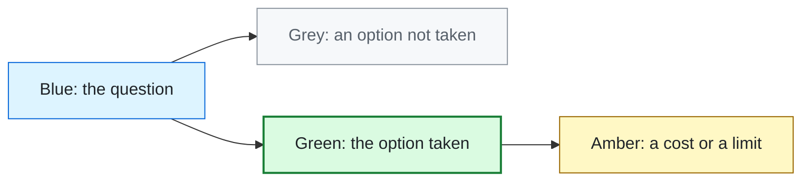

# Technical Guide

These pages explain how the support desk works, why it was built the way it was, and what each choice led to. They are
written for anyone, not only engineers. Each big decision has a small diagram: the question, the options, the pick, and
what was measured afterwards.

| Page | Read it to learn |
|---|---|
| [How it works](how-it-works.md) | One ticket's trip from arrival to its team, and where the model comes from |
| [Design choices](design-choices.md) | The six decisions that shaped the desk, each with its measured result |
| [The version that did not ship](the-version-that-did-not-ship.md) | A model update we tested hard and chose not to release, and why |
| [Reading the numbers and upkeep](reading-the-numbers.md) | What each number on the desk means, where it comes from, and the routine checks |

## How to read the diagrams

Every number in these pages links to the file it comes from. When a number changes, that file changes first.
