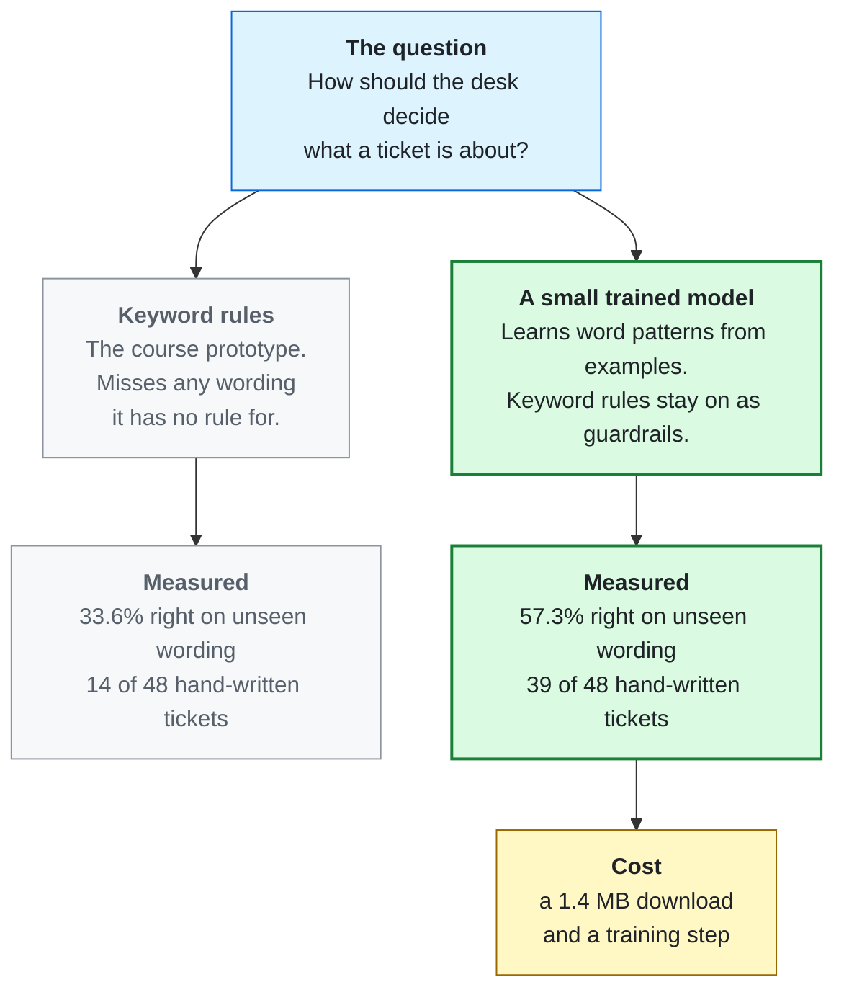
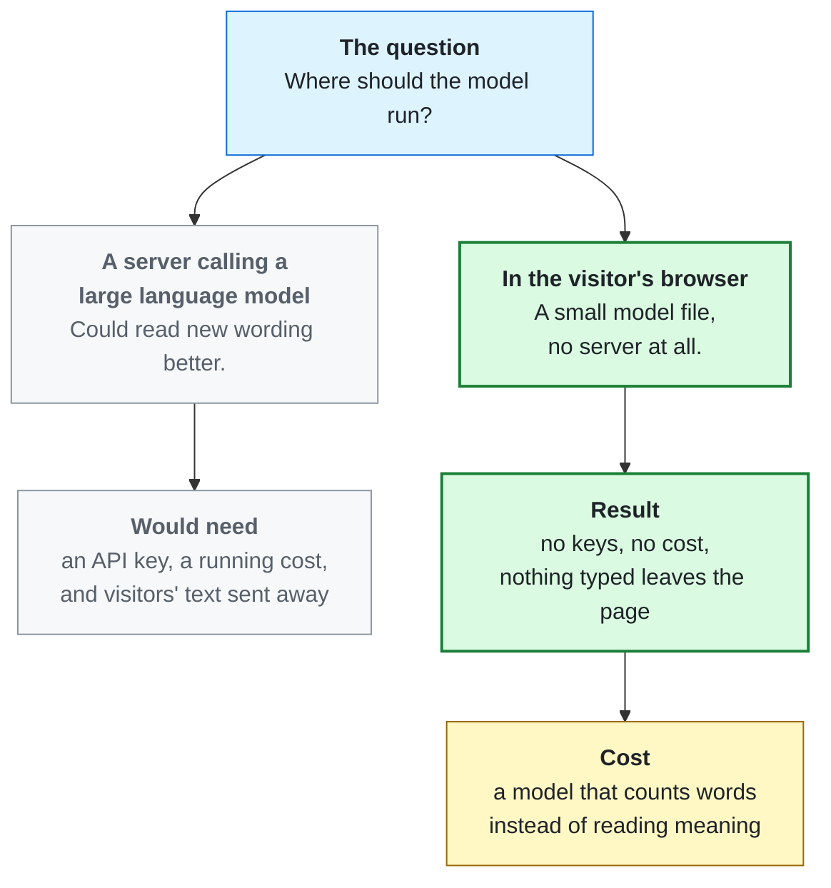
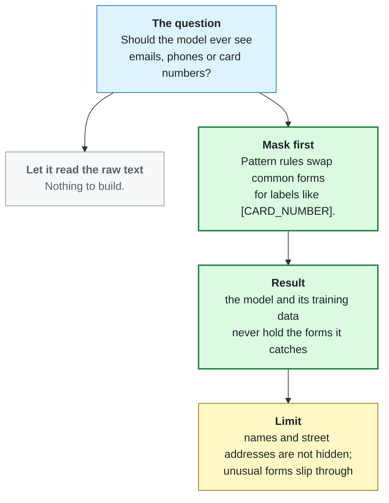
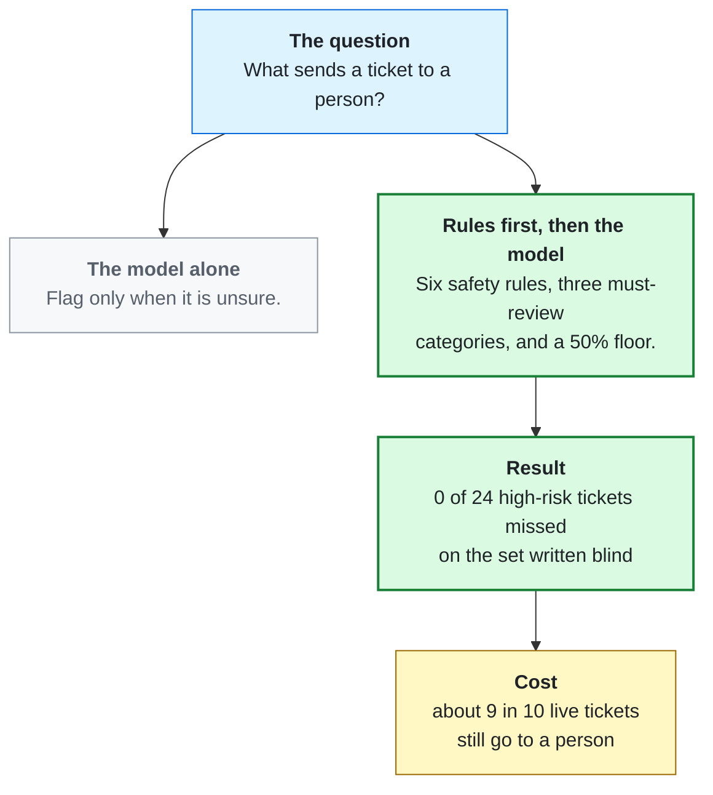
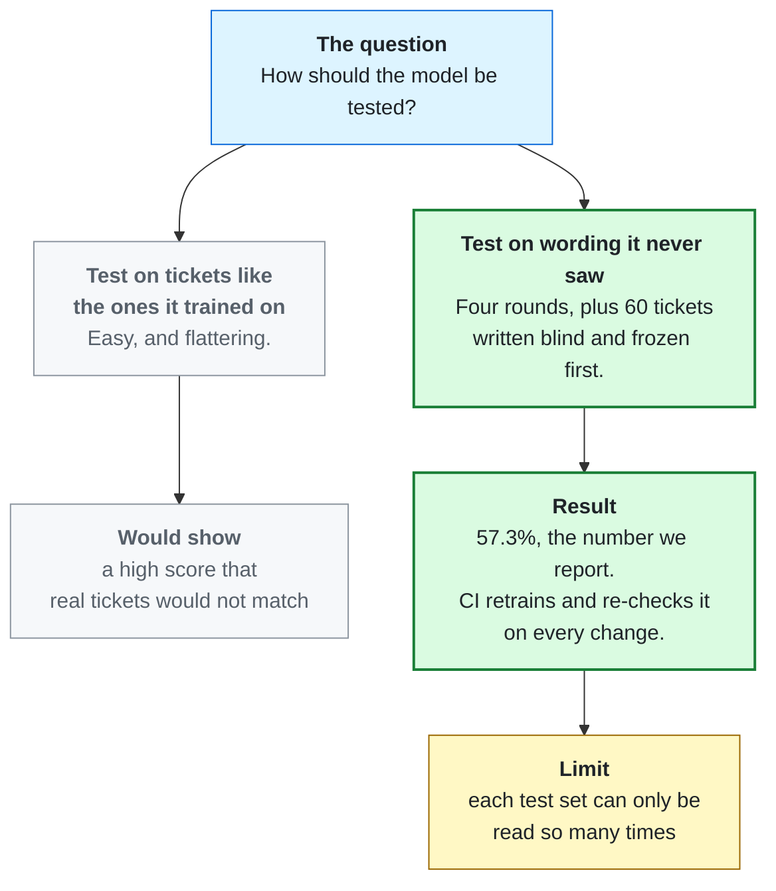
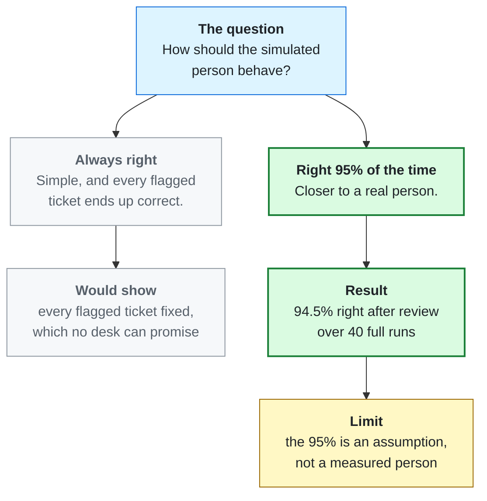

# Design Choices

Six decisions shaped the desk. Each card shows the question, the options, the pick, and what was measured once it was
built. Green is the path taken. Amber is what it cost.

## 1. Keywords or a trained model?

The course prototype sorted tickets with keyword rules. The question was whether a model trained on examples would
do better on wording it had never seen.

**Outcome:** about 1.7 times as many right answers. The model is a simple, well known type (word counts into logistic
regression) because it is quick to train, runs in a browser and can show which words drove each answer. Numbers:
[`MODEL_CARD.md`](../../ml/MODEL_CARD.md#results-against-v0).

## 2. In the browser, or on a server?

**Outcome:** the site is static and free to host. The model file's size is checked on every change so the page stays
quick on a phone ([`size-budgets.json`](../../web/size-budgets.json)). A small pretrained sentence model in the
browser was kept as a later option; it would add about 23 MB.

## 3. Hide personal details before the model reads them?

**Outcome:** the same masker runs on training data and on anything a visitor types. Its known misses are listed in the
[model card](../../ml/MODEL_CARD.md#limits), not hidden.

## 4. Who decides when a ticket needs a person?

This is the choice with the biggest trade-off. Sending more tickets to a person is safer but saves less work.

**Outcome:** safety came first, with a known gap. The blind set is small: 24 high-risk tickets. On the four larger test
rounds, 72 of 5,856 high-risk tickets (1.2%) got past every check
([design spec, section 6](../superpowers/specs/2026-10-29-v1-triage-demo-design.md#6-success-charter)), and across 40
full live runs, 30 did, in 17 of the runs ([`MODEL_CARD.md`](../../ml/MODEL_CARD.md#on-the-desk)). Cutting
the share sent to a person without losing safety became the next version's goal. That story is in
[The version that did not ship](the-version-that-did-not-ship.md).

## 5. How do we know the numbers are honest?

**Outcome:** the published numbers come from a file CI rebuilds on every push, and the check fails if anyone edits
them by hand ([`ci.yml`](../../.github/workflows/ci.yml)). The limit matters: every time a test set guides a choice,
it becomes a little less of a fair test. The update that did not ship read the test rounds six times, so the next try
needs a new test stream.

## 6. A perfect reviewer, or a realistic one?

**Outcome:** the after-review number is labelled as resting on that assumption wherever it appears
([`reviewer.ts`](../../web/src/pipeline/reviewer.ts), [`MODEL_CARD.md`](../../ml/MODEL_CARD.md#on-the-desk)).
