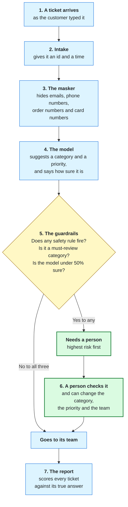
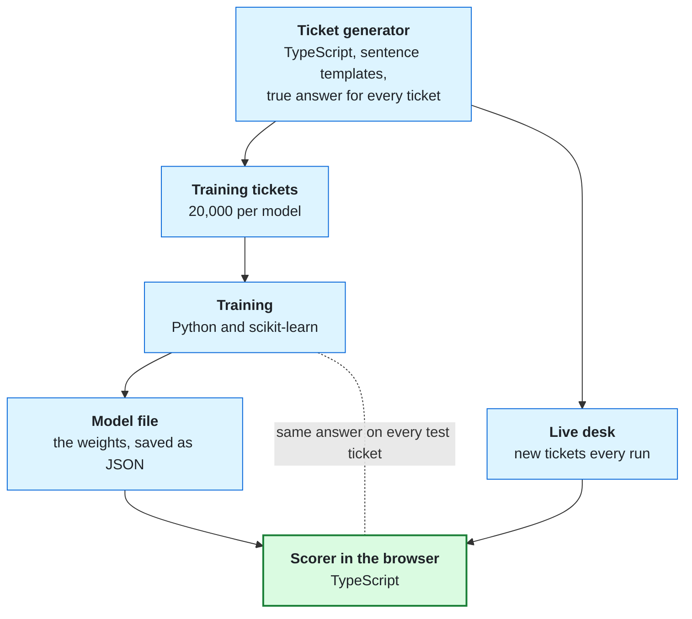
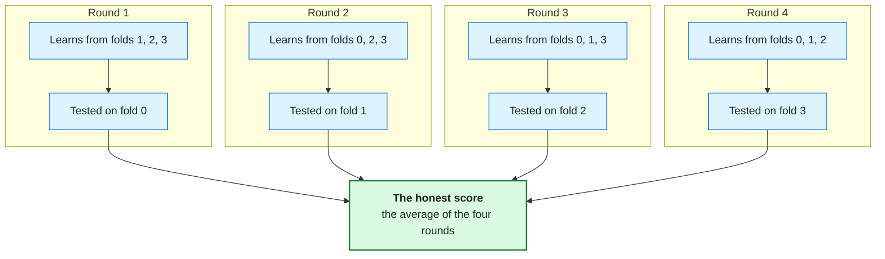

# How It Works

The desk sorts each support ticket into one of nine categories and one of four priorities, then decides whether a
person must check it before it goes to a team. A trained model makes the suggestion. Plain rules decide what a person
must see. Everything runs in the browser.

## One ticket's trip

**The model only suggests.** It never sends a reply, closes a ticket, or lowers a priority that a rule raised. The
rules can overrule the model. The model can never overrule the rules
([`guard.ts`](../../web/src/pipeline/guard.ts)).

### The masker

Plain pattern rules, no AI. Common forms of email addresses, phone numbers, order numbers and card numbers become
labels such as `[CARD_NUMBER]` before the model reads anything ([`mask.ts`](../../web/src/privacy/mask.ts)). It does
not hide names or street addresses, and a form it does not know (an email spelled out as "jane at example dot com")
reaches the model. The [model card](../../ml/MODEL_CARD.md#limits) lists the forms it misses.

### The model

Two small classifiers: one picks the category, one picks the priority. Each counts the words and word pairs in a
ticket, weighs them, and turns the total into a "how sure" score for every answer. In machine learning terms this is
TF-IDF features into logistic regression. The words that pushed hardest toward the answer are shown on the ticket as
the "why".

### The guardrails

Six keyword rules look for tickets a person must always see. Each one can also raise the priority, never lower it
([`rules.ts`](../../web/src/pipeline/rules.ts)):

| Rule | Raises the priority to at least |
|---|---|
| Security incident | Urgent |
| Threatening language | Urgent |
| Accessibility issue | High |
| Escalated complaint | High |
| Billing dispute | Medium |
| Vague ticket | Medium |

Two more checks flag a ticket: the model's answer is Security Concern, Accessibility Support or Urgent Complaint
(these always get a person), or the model is less than 50% sure of the category
([`run.ts`](../../web/src/pipeline/run.ts)).

### The person

On the live desk a simulated reviewer checks flagged tickets. It knows each ticket's true answer and is wrong on
purpose 5% of the time, so it acts like a person, not a perfect answer key
([`reviewer.ts`](../../web/src/pipeline/reviewer.ts)). You can take any ticket yourself. A one-press Approve shows
only when the model is at least 70% sure ([`engineTypes.ts`](../../web/src/run/engineTypes.ts)).

## Where the model comes from

The tickets are made up. A generator writes them from sentence templates, and the same code feeds both the training
and the live desk.

Training happens once, in Python. The browser only reads the saved weights, and a check proves the browser scorer
and Python give the same answer on every test ticket ([`MODEL_CARD.md`](../../ml/MODEL_CARD.md#what-it-is)).

## Testing on wording the model never saw

A model that is tested on sentences it trained on looks better than it is. So the templates are split into four
groups, called folds. Each test model learns from three folds and is scored on the fourth.

Two more test sets sit outside the generator: 48 tickets written by hand, and 60 more written blind and frozen before
any measurement. The live desk uses the same idea: each run plays one fold's wording, scored by the model that never
learned it. More on what each number means: [Reading the numbers](reading-the-numbers.md).

## What it is not

- Not connected to a real help desk. The tickets are made up and the reviewer is simulated.
- No server. The site is static, makes no calls after loading its model file, and stores nothing.
- Not a language model. It counts words and word pairs; it does not understand meaning or negation.
