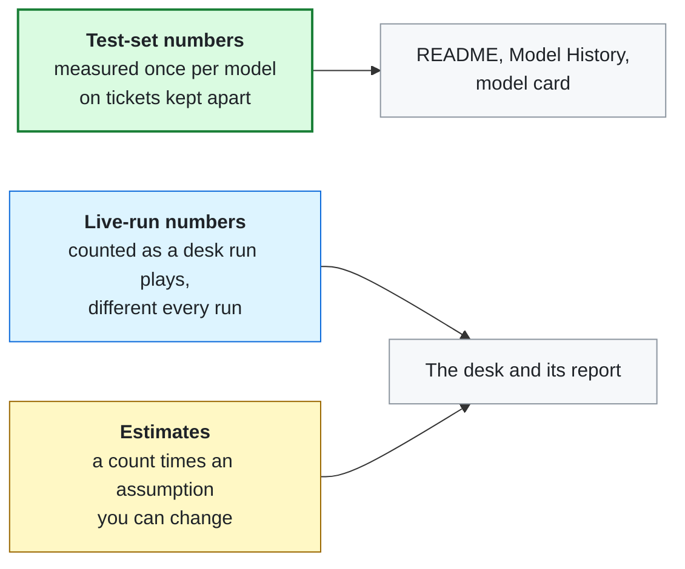
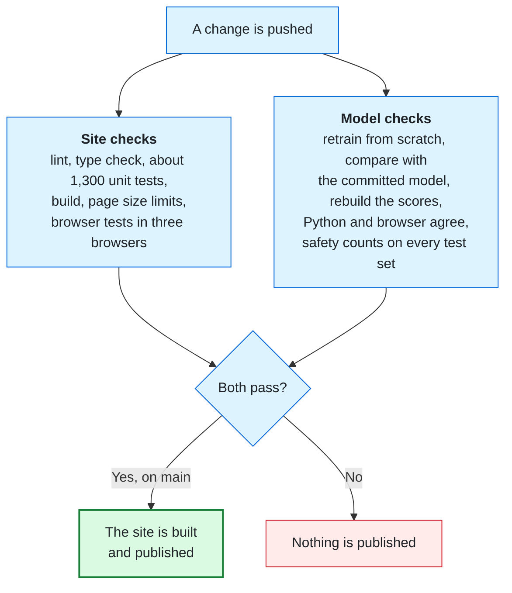

# Reading the Numbers and Upkeep

Every number the desk shows is either measured or a stated assumption. This page says which is which, where each one
comes from, and what to keep in mind when reading it. The second half covers the routine checks that keep the
numbers true.

## Three kinds of numbers

### Test-set numbers (the fairest)

| Number | What it means | Keep in mind | Source |
|---|---|---|---|
| Category right on unseen wording: 57.3% | Average of four rounds, each on wording that model never trained on | The weakest round is 48.6% | [`eval.json`](../../ml/reports/eval.json) |
| Hand-written tickets: 39 of 48 | The shipped model on tickets written outside the generator | Same author as the templates, and 48 is small, so it is a sanity check, not a proof | [`MODEL_CARD.md`](../../ml/MODEL_CARD.md#limits) |
| High-risk missed: 0 of 24 | Risky tickets that got past every check, on 60 tickets written blind and frozen before measuring | A small sample. The four larger test rounds miss 72 of 5,856 (1.2%), and at that rate 24 tickets would show fewer than one miss | [`history.json`](../../web/src/history/history.json), [design spec](../superpowers/specs/2026-10-29-v1-triage-demo-design.md#6-success-charter) |
| Checked by the operator: 78% | Share of that blind set flagged for the operator | Higher on live runs | [`history.json`](../../web/src/history/history.json) |

The sentence model, measured the same way (the desk now runs both models; see the [model card](../../ml/MODEL_CARD.md#the-sentence-model)):

| Number | What it means | Keep in mind | Source |
|---|---|---|---|
| Category right on unseen wording: 83.9% | The same four rounds as the word model's 57.3% | The weakest round is 78.3% | [`sentence_folds.json`](../../ml/reports/sentence_folds.json) |
| Hand-written tickets: 45 of 48 | The shipped sentence model on the same 48 | Same caveat: one author, a small set | [`bundle_v2.json`](../../ml/reports/bundle_v2.json) |
| Blind set: 90.8% (word model 69.6%) | 2,000 tickets in wording no model trained or was tuned on, read once after every model was frozen | 53 of them come from templates close to the training wording; without them, 90.5% against 68.7% | [`blind_reading.json`](../../ml/reports/blind_reading.json) |
| Checked by the operator: 83% (was 78%) | Both models on the 60-ticket blind set, on the first two-model desk | Higher, on purpose: there a ticket left alone only when both models agreed | [`two_model_sets.json`](../../ml/reports/two_model_sets.json) |
| High-risk missed: 0 of 24 | Both models on the same set | On the 2,000-ticket blind set, 38 still got out (61 with the word model alone) | [`blind_reading.json`](../../ml/reports/blind_reading.json) |

The desk today splits routing from risk ([how it works](how-it-works.md)). On the same 60 blind tickets:

| Number | What it means | Keep in mind | Source |
|---|---|---|---|
| Waited for the operator: 24 of 60 (40%) | Tickets the two models placed differently, or too vague to place | 26 more went straight to their team marked as needing a person, so 50 of 60 still reached a person | [`split_flow.json`](../../ml/reports/split_flow.json) |
| High-risk missed: 0 of 20 | The 20 tickets with one of the five risk reasons | Counted without the 4 vague tickets, which are a routing doubt, not a risk | [`split_flow.json`](../../ml/reports/split_flow.json) |

### Live-run numbers

The desk deals tickets in its own wording, which neither model trained on. Over 4,000 of them
([`two_model_sets.json`](../../ml/reports/two_model_sets.json)):

| Number | Word model alone | Both models, first two-model desk | Keep in mind |
|---|---|---|---|
| Sent to a person | 79.6% | 83.3% | On that desk the second model only ever added tickets for a person |
| Suggestion right on category, on those sent to a person | 1,819 of 3,333 (54.6%) | 2,494 of 3,333 (74.8%) | The word model's own answer against the sentence model's, on the same tickets |
| High-risk tickets out without a person | 83 | 73 | The most important line in a run's report |
| High or Urgent tickets out as Low or Medium | 3 | 0 | |

On the same 4,000 tickets, the desk that splits routing from risk sends 1,915 (47.9%) to the operator and 1,418
straight to their team marked as needing a person. Risky tickets out with no person stay at 55 and High or Urgent
out low at 0, the same as the first two-model desk on the same tickets; 301 marked tickets reach the wrong team
first ([`split_flow.json`](../../ml/reports/split_flow.json)).

Each run is random, so a single run can differ from these. The seed is shown, so any run can be replayed exactly.
The first release's desk, on the word model alone, is described in the [model card](../../ml/MODEL_CARD.md#on-the-desk).

### Estimates

| Number | How it is worked out | Keep in mind |
|---|---|---|
| Time saved | Each ticket sorted fully right with no person touching it counts as 2 minutes | Vendors of IT desk tools put sorting a ticket at 3 to 12 minutes; that range comes from two vendors and we found no independent study, so 2 minutes sits below both. A ticket sorted wrong saves nothing, but the cost of someone finding and redoing it is not subtracted. |
| Value saved | Time saved times $21.53 an hour | The US median pay for customer service representatives (Bureau of Labor Statistics, May 2025), without benefits |

You can change both assumptions on the desk. The formula: [`valueSaved.ts`](../../web/src/run/valueSaved.ts).

## What to look for in a run

- **The operator's list, highest risk first.** It is called Check the route with both models and Needs a person with
  the word model alone. If a Security or Urgent ticket sits low in it, something is wrong.
- **Rows marked Needs a person in Sent to teams.** With both models, a risky ticket goes straight to its team with
  that mark and its priority, at least High unless a person set it.
- **The words on each ticket.** They show what drove the model's answer. When an answer is wrong, they show which words misled it.
- **The report's misses.** A high-risk ticket that went out without a person is the most important line in the report.
- **Approve.** With the word model alone, it shows only when the ticket's card reads 70% sure or more. With both
  models no card offers it: every card is a route the operator places. Wrong quick approvals are counted in the report.

## Upkeep

### What runs on every change

All of it lives in one file: [`ci.yml`](../../.github/workflows/ci.yml). The safety counts are the start point each
test set may not get worse than: high-risk missed, share sent to a person, and unchecked wrong answers. A new model
may lower them; it may never raise them.

### Routine jobs

| Job | When | How |
|---|---|---|
| Run the full check locally | Before any pull request | `npm --prefix web run gate`, then `npm --prefix web run e2e` |
| Retrain the model | After the generator or training code changes | `npm --prefix web run export-data` writes the tickets; then from `ml/`, `python -m triage.export_model --folds-out ../web/public/models` and `python -m triage.evaluate` ([model card](../../ml/MODEL_CARD.md)) |
| Add a Model History row | When a new model ships | A new entry on top of [`history.json`](../../web/src/history/history.json), every number measured on the baseline's own tests; [`sources.test.ts`](../../web/src/history/sources.test.ts) holds each to its report |
| Update a dependency | When a fix is out | Versions are pinned exactly, and the project adds only versions at least 14 days old; Python packages are pinned by hash in [`requirements.txt`](../../ml/requirements.txt) |
| Raise a page size limit | Only when a measured change needs it, after looking for waste first | [`size-budgets.json`](../../web/size-budgets.json) |

### What would need a person's decision

- Raising any start point (letting a set get worse), even by one ticket.
- Training on a test set, or reading the frozen blind set while choosing a setting.
- Changing the simulated reviewer's 95%, which every after-review number rests on.
