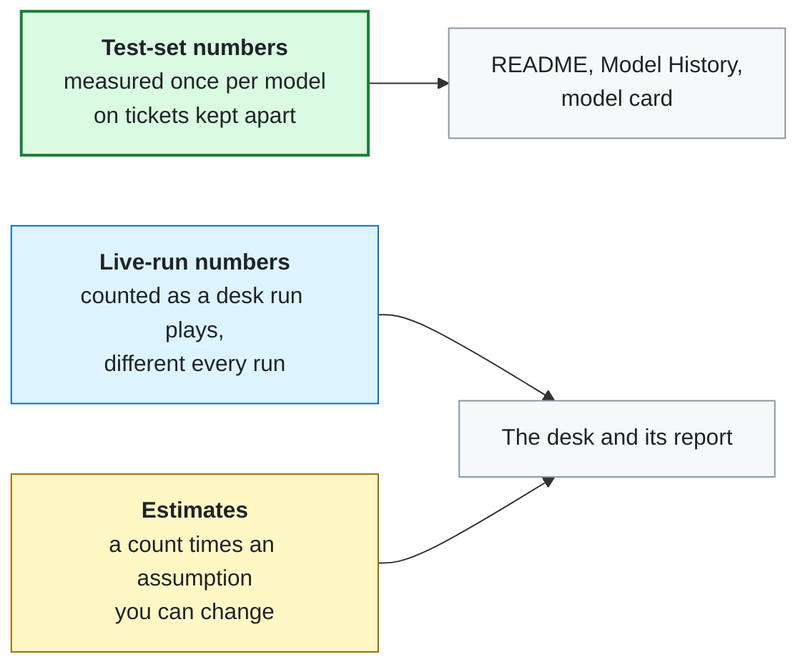
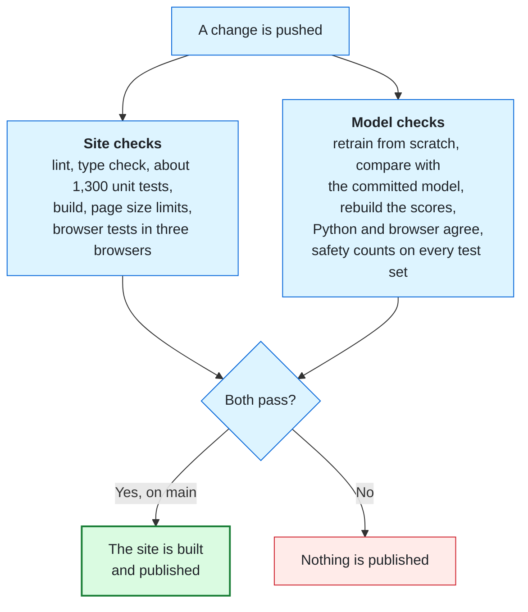

# Reading the Numbers and Upkeep

Every number the desk shows is either measured or a stated assumption. This page says which is which, where each one
comes from, and what to keep in mind when reading it. The second half covers the routine checks that keep the
numbers true.

## Three kinds of numbers

### Test-set numbers (the fairest)

| Number | What it means | Keep in mind | Source |
|---|---|---|---|
| Category right on unseen wording: 57.3% | Average of four rounds, each on wording that model never trained on | The weakest round is 48.6% | [`eval.json`](../../ml/reports/eval.json) |
| Hand-written tickets: 39 of 48 | The shipped model on tickets written outside the generator | Same author as the templates, and 48 is small, so it is a sanity check, not a proof | [`MODEL_CARD.md`](../../ml/MODEL_CARD.md#limits) |
| High-risk missed: 0 of 24 | Risky tickets that got past every check, on 60 tickets written blind and frozen before measuring | A small sample. The four larger test rounds miss 72 of 5,856 (1.2%), and at that rate 24 tickets would show fewer than one miss | [`history.json`](../../web/src/history/history.json), [design spec](../superpowers/specs/2026-10-29-v1-triage-demo-design.md#6-success-charter) |
| Sent to a person: 78% | Share of that blind set flagged for a person | Higher on live runs | [`history.json`](../../web/src/history/history.json) |

### Live-run numbers

Counted over 40 full desk runs of 130 tickets each, seeds 2000 to 2039, with no one stepping in
([`MODEL_CARD.md`](../../ml/MODEL_CARD.md#on-the-desk)):

| Number | Result | Keep in mind |
|---|---|---|
| Category right, model alone | 58% | Close to the test-set number, as it should be |
| Category right after review | 94.5% | Rests on a simulated reviewer assumed right 95% of the time |
| Sent to a person | 89% | The model is cautious; cutting this was the [next version's goal](the-version-that-did-not-ship.md) |
| High-risk tickets out without a person | 30, in 17 of the 40 runs | Live runs use the same unseen wording as the four test rounds, so read this beside their 1.2% miss rate, not beside 0 of 24 |

Each run is random, so a single run can differ from these averages. The seed is shown, so any run can be
replayed exactly.

### Estimates

| Number | How it is worked out | Keep in mind |
|---|---|---|
| Time saved | Each ticket sorted fully right with no person touching it counts as 2 minutes | Vendors of IT desk tools put sorting a ticket at 3 to 12 minutes; that range comes from two vendors and we found no independent study, so 2 minutes sits below both. A ticket sorted wrong saves nothing, but the cost of someone finding and redoing it is not subtracted. |
| Value saved | Time saved times $21.53 an hour | The US median pay for customer service representatives (Bureau of Labor Statistics, May 2025), without benefits |

You can change both assumptions on the desk. The formula: [`valueSaved.ts`](../../web/src/run/valueSaved.ts).

## What to look for in a run

- **Needs a person, highest risk first.** If a Security or Urgent ticket sits low in that list, something is wrong.
- **The words on each ticket.** They show what drove the model's answer. When an answer is wrong, they show which words misled it.
- **The report's misses.** A high-risk ticket that went out without a person is the most important line in the report.
- **Approve.** It shows only when the ticket's card reads 70% sure or more. Wrong quick approvals are counted in the report.

## Upkeep

### What runs on every change

All of it lives in one file: [`ci.yml`](../../.github/workflows/ci.yml). The safety counts are the start point each
test set may not get worse than: high-risk missed, share sent to a person, and unchecked wrong answers. A new model
may lower them; it may never raise them.

### Routine jobs

| Job | When | How |
|---|---|---|
| Run the full check locally | Before any pull request | `npm --prefix web run gate`, then `npm --prefix web run e2e` |
| Retrain the model | After the generator or training code changes | `npm --prefix web run export-data` writes the tickets; then from `ml/`, `python -m triage.export_model --folds-out ../web/public/models` and `python -m triage.evaluate` ([model card](../../ml/MODEL_CARD.md)) |
| Add a Model History row | When a new model ships | A new entry in [`history.json`](../../web/src/history/history.json); the baseline stays below it |
| Update a dependency | When a fix is out | Versions are pinned exactly, and the project adds only versions at least 14 days old; Python packages are pinned by hash in [`requirements.txt`](../../ml/requirements.txt) |
| Raise a page size limit | Only when a measured change needs it, after looking for waste first | [`size-budgets.json`](../../web/size-budgets.json) |

### What would need a person's decision

- Raising any start point (letting a set get worse), even by one ticket.
- Training on a test set, or reading the frozen blind set while choosing a setting.
- Changing the simulated reviewer's 95%, which every after-review number rests on.
