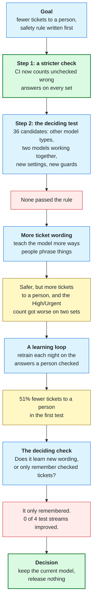
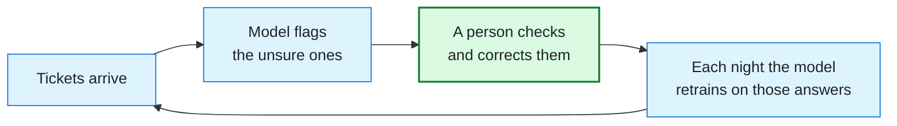

# The Version That Did Not Ship

After version 1.0, the next goal was simple to say: **send fewer tickets to a person.** About 9 in 10 live tickets
were going to a person, so the desk saved little work. We tested many ways to cut that share. None of them met the
safety rule we set first, so we kept the current model. This page explains how we got to that decision.

## The rule we set before testing

Fewer tickets for a person is only worth it if the risky ones still reach a person. So, before any test, we wrote
the rule down. On every test set, a new model must not:

- send more High or Urgent tickets out unchecked as Low or Medium,
- miss more high-risk tickets (the ones a person must see),
- give more wrong answers that nobody checks.

A model that cut flags but broke any line of this rule on any one set would fail. The full plan:
[`2026-11-08-fewer-flags-plan.md`](../superpowers/specs/2026-11-08-fewer-flags-plan.md).

## The path, step by step

Red marks a result that failed the rule. Amber marks a result that looked good but had a catch. Green marks what we kept: the stricter check (it shipped and now guards every
change) and the final decision.

## What each step found

### Step 2: a better model gave fewer wrong answers, not fewer flags

We tried 36 candidates in three rounds. Before any of them, we checked that our test setup gave exactly today's numbers
when run on today's model. It did. Then:

| What we tried | What happened |
|---|---|
| Other model types (naive Bayes, ridge, linear SVM) | Some were right more often, but each broke the rule on at least one set |
| Two models working together, each handling the categories it is best at | Far fewer unchecked wrong answers (77 to 15 on one set), but more tickets to a person |
| New settings for today's own model | Failed by one missed ticket on one set |

The last row matters. Even today's own model, with only its settings moved, failed the rule by a single ticket. A rule
with zero room on every set punishes any change, including a harmless one.

### More wording: safer, not leaner

Writing more ways to phrase each kind of ticket made the model much safer. On the test sets, missed high-risk tickets
fell from 71 to 9. But it sent 4% more tickets to a person, and the count of High or Urgent tickets sent out low got
worse on two of the four sets. That broke the rule.

### The learning loop: memory, not learning

The most promising idea was to let the desk learn from the person who checks it. Every flagged ticket gets a correct
answer from a person; a model that retrains on those answers each night should need a person less over time.

In the first simulation, tickets sent to a person fell by 51% and every safety count improved. That looked like the
answer. But the generator repeats its wording, so the model might only be remembering sentences it had already seen
checked. We wrote a test for that before building anything: teach the model from half the ticket templates, then
measure it only on the other half.

| Test stream | Tickets to a person, model never learns | Model learns from the other half |
|---|---|---|
| Fold 0 | 1,133 | 1,143 |
| Fold 1 | 934 | 940 |
| Fold 2 | 895 | 912 |
| Fold 3 | 1,213 | 1,183 |

On new wording it flagged more on three of the four streams. The one that improved sent one more High or Urgent ticket
out low. So the 51% was memory of checked wording, not learning. By the rule we wrote before the test, the plan stopped
there.

## What we kept, and what comes next

- **Kept:** the current model, and the stricter CI check from Step 1. Every future change is held to the same counts.
- **Learned:** a better word-counting model buys fewer wrong answers, not fewer flags. The next lever is a model that
  reads new wording better, such as a small pretrained sentence model.
- **Needed first:** a fresh test stream. These test sets were read six times while choosing, so they are no longer a
  fair test for the next try.

Stopping here is the result, not a failure to finish. The rule was set before the numbers came in, and the numbers
did not meet it.
