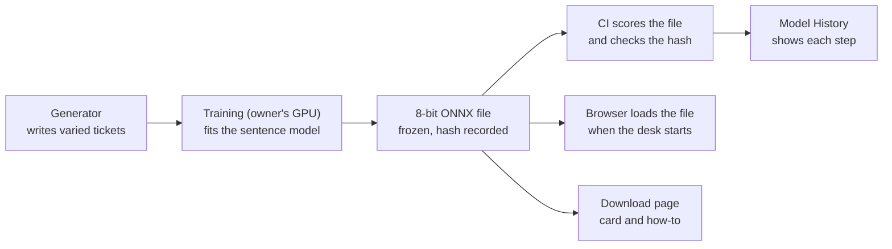

# A Model That Reads Meaning - Design

**Date:** 2026-11-10. **Status:** approved by the owner on 2026-11-10 ("Let's go through recommendations for all the things that we found ... We need accuracy above everything else"), read as a yes to the three proposals: desk-only wording, the allowance, and the 90-day pass mark.

> **REVISED (2026-11-11): two models, not one - see "Revision 1" at the end.** The single-model approach of section 7, the allowance of section 9 and phases 2 to 4 are superseded where Revision 1 says so.

**Intent record (the owner's words):** `docs/brainstorms/2026-11-10-next-model.brainstorm.md` (local). **Evidence:** four offline tests run 2026-11-10 on the 12 practice rounds; scripts and outputs live in the session scratchpad by the owner's rule (2026-11-08), and every number used here is copied into section 2.

## 1. Intent and why

The shipped model counts words. Its four fold models, each scored on wording it has not seen, get the department right 57.3% of the time on average ([`ml/MODEL_CARD.md`](../../../ml/MODEL_CARD.md); "department" here is the repo's `category`), and the last version found no word-counting change that passed its safety rule ([`2026-11-08-fewer-flags-plan.md`](2026-11-08-fewer-flags-plan.md)). The owner wants a model that is right more often, never trades High or Urgent safety, and can be shown getting better over time by learning the task, not by remembering tickets.

## 2. What we measured (practice data only)

Twelve rounds: train on a tuning set built from two folds' wording, score on each of the two folds left out (4,000 tickets each, no scored text in its training set). These folds have been read 6 times before, so they are practice data from now on and judge nothing.

| Step | Right department | Right priority | High/Urgent called Low or Medium | High-risk with wrong department |
|---|---|---|---|---|
| 0. Today's word recipe | 52.4% | 56.0% | 5,276 | 5,899 |
| 1. Sentence model as it comes, best of 4 settings | 66.8% | 60.5% | 5,450 | 6,300 |
| 2. Step 1 voting with the word model | 68.9% | 64.3% | 4,480 | 5,057 |
| 3. Sentence model trained on our tickets | 81.5% | 71.0% | 2,799 | 3,151 |

- Control: the setup reproduced the model card's fold 0 count exactly (2,325 of 4,000) before any comparison.
- Step 3 beat step 1 on 12 of 12 rounds. Its High/Urgent count was worse than today's on 1 of 12 rounds.
- These are raw model answers, before the rules, the floor and the review step. One training run, one setting, one seed.
- Browser format, measured on one round's trained model: the 8-bit ONNX file is 22,843,709 bytes (full: 90,362,390). The full file gave the same answers as PyTorch on 8,000 of 8,000 tickets. The 8-bit file gave the same department on 3,816 and 3,866 of 4,000 and was as accurate (3,461 vs 3,452; 3,093 vs 3,108). In headless Chromium on the owner's PC it loaded from local disk in 0.6 s and scored a ticket in 4.7 ms. The largest gap between the browser's and Python's embedding numbers on the same 8-bit file was 0.023. The browser runtime file is 26,861,777 bytes and the tokenizer 711,649 bytes, uncompressed.
- Not measured: phone speed and memory, compressed sizes, real network load time, how many answers the 0.023 gap changes.

## 3. Goals

1. **Right department more often on wording not seen**, judged once on a new blind test set (record Q1, owner's words).
2. **The two hard lines hold on every set**: no more High/Urgent tickets sent out unchecked as Low/Medium, no more high-risk tickets missed (owner, 2026-11-08; record Q2).
3. **Growth over time is shown and is real**: a 90-day offline run where the model retrains on answers a person checked and is scored only on wording it has not been taught (record Q1; option A, 2026-11-10).
4. **Training tickets are more varied** in length, detail and unique cases, with no repeated texts (record Q6, owner's words).
5. **Anyone can get the model**: a download with its model card and a load how-to (record Q8).

Tickets sent to a person is reported for every step and is the second priority, not a release gate (record Q1 and Q3).

## 4. Non-goals and anti-goals

- **Not built:** retraining in the browser (option C; the largest build, and the 90-day run answers the question first); new categories or languages (not asked); automatic replies (owner, 2026-11-05); real customer tickets in training (data boundary; a public set is researched for testing only).
- **Failure even if it works:** a gain that comes from remembered wording; any hard line worse on any set; a number on the site that describes a model visitors do not run; a typed ticket, or anything about a visitor, leaving the browser; a page that cannot be used until 50 MB has loaded.

## 5. Constraints

- Everything runs in the browser, with zero operator cost. Model, tokenizer and runtime files are served from the site itself; the page calls no outside service at run time.
- The model is `sentence-transformers/all-MiniLM-L6-v2`, Apache 2.0 (page read 2026-11-10); its notice ships with the download.
- New packages are pinned exactly and are at least 14 days old, as in `ml/requirements.txt`.
- `RANDOM_STATE = 113` everywhere a seed is taken.
- Every bar is written in the plan before the numbers it judges are read.

## 6. What the owner decided

| Date | Decision |
|---|---|
| 2026-11-08 | High/Urgent and missed high-risk are never traded. Measurement scripts stay out of the repo. |
| 2026-11-10 | Model work is the next feature; the download is its last step. |
| 2026-11-10 | Zero room on the two hard lines; a small written allowance on the other lines (Q2). |
| 2026-11-10 | More accurate with no safety line worse is enough to release (Q3). |
| 2026-11-10 | Blind test set: new templates written blind and read once; a public real-ticket set is researched and reported (Q5). |
| 2026-11-10 | The 90-day run is in this version as an offline measured simulation (option A). |
| 2026-11-10 | Direction: the sentence model, after it passed its bar (12 of 12 rounds, +11.4 points). |
| 2026-11-10 | Improve in increments, not one jump. |
| 2026-11-10 | The 8-bit (small) format. |
| 2026-11-10 | Download on GitHub and a Hugging Face page; the public post stays the owner's act (Q8). |

## 7. The approach

**One trained sentence model with two answer heads (department, priority), shipped as an 8-bit ONNX file that is the model of record.** Python scores that exact file, the browser runs that exact file, and every published number comes from it.

**Desk wording is set aside, so one file is enough (proposed, the owner's to lock).** Today the desk scores each run with one of four fold models, so a run's wording is always new to its model (`web/src/page/fetchModel.ts`). Four trained sentence models plus the shipped one would be about 114 MB of model files. Instead, one share of the generator's templates becomes desk-only wording that no model trains on, and one model trained on all the other wording scores both the desk and Try a ticket. The desk stays honest and the site holds one 23 MB model file.

**What CI checks.** CI scores the one frozen file on the desk-only wording, the two hand-written sets and, after phase 6, the blind set, and compares each count with its recorded value. The practice rounds need models trained on parts of the wording; those are trained on the owner's GPU by a script kept in `ml/`, and their numbers are recorded once in a report, marked as recorded and not re-derived by CI. Model History shows only numbers CI checks.

Rejected: four fold models of the new kind (about 114 MB of files and four hashes for the same honesty); one model that has seen the desk's wording (a gain from memory, section 4); more word-model variants (36 failed the last bar); the sentence model untrained (66.8%, and High/Urgent got worse); the full 90 MB format (4 times the download for the same accuracy); a bigger sentence model (not needed yet; a later rung).

**Built in phases, each with a gate, on one branch:**

| Phase | What | Gate |
|---|---|---|
| 0 | Blind test set written and frozen with its hash; report on public real-ticket sets | Owner sees the report; the set stays unread |
| 1 | More varied generator templates for training | No repeated texts; practice accuracy not lower |
| 2 | Training pipeline in the repo; better settings; a check trained only for "High or Urgent?" | Practice rounds: hard lines not worse than today on any round |
| 3 | The rules, floor and review step on top of the new model; the written allowance | Practice rounds pass the bar of section 9 |
| 4 | The 90-day run, scored only on wording not yet taught | Its pass mark, written first |
| 5 | Browser: the file loads on demand, the desk works while it loads, close-match test | Browser tests green |
| 6 | One reading of the blind set for every step; Model History, model card, guide, download page | Owner's go to release |

Each step of the ladder becomes a Model History row, all scored in the single blind-set reading, so growth is shown without reading the set twice.

## 8. Requirements

**Must**
- M1. A blind test set from new templates, frozen and hashed before any model of this version is trained; CI fails if a blind text appears in any training or tuning file.
- M2. A training script in `ml/` that produces the trained model and the 8-bit ONNX file from the exported tickets.
- M3. The 8-bit file is the model of record: its SHA-256 is recorded in the repo, and CI scores that file and fails if the hash or the scores differ from the recorded ones.
- M4. A check for High/Urgent tickets that holds the hard lines on every set.
- M5. The desk runs the new model in the browser, loaded only when a visitor starts the desk or types a ticket, with the page usable before it arrives.
- M6. A close-match test between browser and Python on the same file, with its limit written first.
- M7. Model History, the model card and the matching `docs/guide/` pages show the new numbers from their source files (lesson L-12: tests read expected values from the source file).
- M8. The 90-day offline run and its result on Model History.
- M9. The download: the model file, model card and load how-to.

**Should**
- S1. More varied training templates (goal 4). It is a Should only because the model can ship without it; it is planned in phase 1.
- S2. The code carry-overs T2-4, T2-6, T2-7, T2-8, H6b, H9, H10 ride on this branch.
- S3. The wider privacy mask (`.kit/reports/u6-check-2026-11-05.md`), since training text changes anyway.

**Later (the design must not block it)**
- Retraining in the browser; a bigger sentence model; a real-ticket test set if a usable one exists.

## 9. Success

**Functional goal (must hit):** on the blind set, read once, the new model of record is right on department at least 10 points more often than the shipped word model scored on the same set, and neither hard line is worse on the blind set, the 60-ticket fresh set, the 48-ticket seen set or any practice round. The model card's floor stays: the seen set does not drop below 39 of 48 on department.

**What "today" means in every comparison:** today's word recipe trained on the same tickets and run through the same rules and review step as the new model. A recorded number from a model trained on different tickets is never the baseline.

**Allowance on the other lines (proposed, the owner's to set):** unchecked wrong departments and unchecked wrong priorities may each be worse than today by at most 0.25% of a set's tickets, rounded down, and never less than 1 ticket (10 on a 4,000-ticket set; 1 on the 60-ticket and 48-ticket sets).

**90-day pass mark (proposed):** on wording not yet taught, department accuracy in days 61-90 is higher than in days 1-30 on at least 3 of 4 streams, with neither hard line worse on any stream.

**Stretch (direction only, not built toward first):** fewer tickets sent to a person than today on the blind set.

## 10. Acceptance criteria

- M1: given the blind file, when any training export runs with a blind text in it, then the export stops with an error and writes nothing.
- M3: given a model file whose hash differs from the recorded one, when CI runs, then CI fails before scoring.
- M5: given a visitor on a slow connection, when the desk page opens, then the page is usable before the model file has loaded, and the visitor sees that the model is still loading; given the load fails, the visitor sees a plain message and nothing is sent anywhere.
- M5: the pages that do not score tickets load no model file.
- M6: given the same 8-bit file and the same tickets, the browser's department and priority answers match Python's within the written limit.
- M7: a test of Model History fails when the page shows a number that differs from its source file.
- What must not happen: a network request to another host at run time; a blind-set score read before phase 6.

## 11. Risks and open questions

| Risk or question | Blocking? | Who settles it |
|---|---|---|
| The 81.5% does not hold on the blind set (templates share filler phrases across folds; one run only) | No; the release gate catches it | Phase 6 |
| The High/Urgent line was worse on 1 of 12 practice rounds | Yes for release | Phase 2 work, measured |
| Training on a GPU is not exactly repeatable, so CI can no longer retrain and compare. CI scores the frozen file instead | No | Design choice, section 12 |
| Phone speed and memory with a 23 MB model and a 27 MB runtime | Yes before phase 5 ends | A device test by the owner |
| Where the 23 MB file lives (in git, or a release file fetched by hash) | No | Builder, section 12 |
| The blind set shares an author with the training templates | No; stated on the model card | A public real-ticket set, if one is usable |
| The allowance, the 90-day pass mark and the desk-only wording are proposals | Yes | The owner, at approval |
| Desk-only wording leaves the desk fewer templates to draw from than today | No | Phase 1 adds templates; the share is measured in the plan |

## 12. Left to the builder, and my calls

**Left to the builder:** file names and layout under `ml/` and `web/src/model/`; training settings; the loading indicator's look within the existing design; test layout.

**My calls (the owner did not decide these; say so if any is wrong):**
1. CI scores a frozen model file by hash and no longer retrains the model on every push. Training happens on the owner's GPU. The current `check_model`, `check_eval` and `measurePipeline --folds` steps are replaced by the checks in section 7; practice-round numbers become recorded, not re-derived.
2. The desk keeps working while the model loads. Whether it shows today's small model's answers first or waits is decided with a wireframe in phase 5.
3. One branch and one release, with the ladder shown as Model History rows, not one release per rung.
4. The functional goal of 10 points on the blind set. The practice gain was 29 points; 10 leaves room for the blind set to be harder.
5. The wider privacy mask is a Should on this branch.
6. "Today" in every comparison is the word recipe on the same tickets (section 9).
7. H11 and H12 are treated as closed by the guide page, as recorded in the Active Plan.

## Revision 1 (2026-11-11): two models, not one

**Locked by the owner on 2026-11-11** ("Lets go with your recommendation, we will update our model history page to show the truth, as well as identifying a way to reduce the tickets to a person but also maintaining our accuracy like we have").

**Why it changed.** Measured on the 12 practice rounds (`ml/reports/practice_v2.json`; the plan's Execution Notes of 2026-11-11 hold every count): the sentence model is far more accurate, but no rule built on its own outputs kept the two hard lines while sending fewer tickets to a person. A rescaled confidence floor, two probability checks and a trained "does a person need to see this?" answer each failed its bar; the last one on 12 of 12 rounds. Most misses were vague tickets and disputed charges that left unchecked with the department right, and high-risk tickets misread on unseen wording.

**What it is now.** Both models run.
- **The word model stays the gate, unchanged.** Its rules and its confidence floor decide, as today, which tickets may leave unchecked.
- **The sentence model gives the answer a person sees.** Every ticket that goes to a person carries the sentence model's department and priority as the suggestion.
- **A ticket leaves unchecked only when today's gate lets it and both models agree** on department and priority. Any disagreement sends it to a person.

**Why it is better, and why that holds.** An unchecked ticket carries the answer today's model gives, and the unchecked tickets are a part of today's unchecked tickets. So on any set, no count of the safety rule can be higher than today's: this follows from the rule itself, not from a tuned threshold. Measured on 48,000 practice tickets: sent to a person 90.1% -> 91.9%; high-risk missed 478 -> 409; High/Urgent out as low 78 -> 17; unchecked wrong department 248 -> 34; unchecked wrong priority 516 -> 273; rounds with any line worse 0 of 12; the suggestion shown to the reviewer right on both fields 37.6% -> 60.3%.

**What it costs.** About 2 points more tickets go to a person, not fewer. The site serves two models: the word model (3.8 MB, as today) and the sentence bundle (about 23 MB plus its runtime), the second loaded after the first so the desk works at once.

**What it supersedes.**
- Section 3: the goal "right department more often" is now measured on the suggestion a reviewer is shown and on the model alone; tickets sent to a person is reported and is expected to rise slightly.
- Section 7: the single model of record. The bundle is still frozen, fingerprinted and scored by CI; the word model keeps its present checks. Phases 2 and 3 are replaced by: train the shipped sentence model on all training wording; measure the two-model rule with the real pipeline on the practice rounds, the desk-only wording and the hand-written sets. Phase 4 (the 90-day run) is re-scoped in Part 2: what grows over the days is how often the suggestion is right.
- Section 9: the allowance is no longer needed, because no line can be worse. The release bar becomes: on the blind set, read once, the suggestion is right on department at least 10 points more often than today's model, and the two-model rule's four counts are at or under today's on every set (a check of the build, since the rule guarantees it).

**What stays open, by the owner's word.**
- **Fewer tickets to a person, with accuracy kept.** Not solved. It stays a named goal for the work after this release; the record of what was tried and why it failed goes on Model History and in the guide.
- **Model History shows the truth:** the new row reports the suggestion's accuracy, the unchanged safety counts and the higher share sent to a person, and says plainly that the workload did not fall.

**Not decided yet (Part 2 design).** Whether the four word fold models stay on the site once the desk draws desk-only wording; how the desk shows a suggestion that arrives after the gate's answer.
